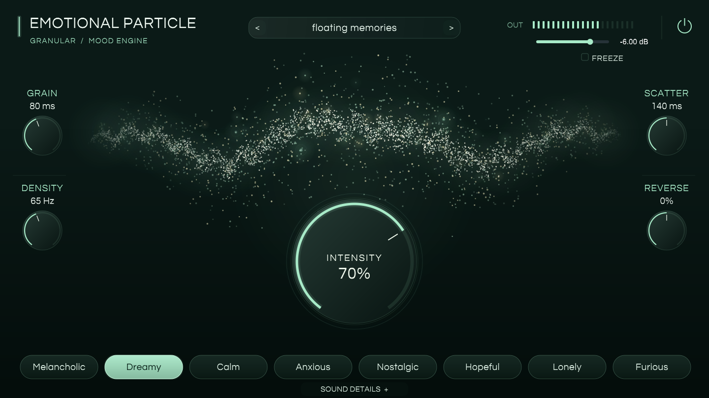

# Emotional Particle

A mood-driven real-time granular audio effect made with JUCE and C++17. Eight moods, 128 fixed grain voices, stereo history/freeze, 800 ms mood morphs, twelve detail controls and an audio-reactive particle interface.

Version 0.6.1 makes audible grains brighter and adds a short afterglow for grains that finish between display frames. Input attacks light up the waveform and send a pulse out from its centre.

Version 0.6 adds absolute 0–100% Mix and 50–125% interface scaling. Mix controls the wet ratio independently of Intensity, which still controls grain variation. Changes ramp over 25 ms to prevent clicks. At 0%, the signal is dry and Output trim still applies. Existing saved projects migrate their old offset to the wet ratio at the saved mood and Intensity. Existing Mix automation now sets the absolute wet ratio.

Use the − and + buttons near the bottom right to change interface size, or drag the resize corner where the host allows it. The default is 75%. Size is saved with the plug-in state.

Version 0.5 increases UI label/value sizes and adds host-echo regression tests, concurrent automation/editor lifecycle stress, parameter sanitisation, filled rotary arcs, and reproducible native platform builds. The plug-in IDs and parameter IDs remain compatible with 0.4.

| Platform | Formats | Build target |
| --- | --- | --- |
| Windows 10/11 | VST3, Standalone | MSVC 2022 x64 |
| macOS 11+ | VST3, AU, Standalone | Universal arm64 + x86_64 |
| Windows/macOS with licensed Avid SDK | AAX (optional) | Requires separate SDK, PACE signing and Pro Tools validation |



## Download builds

Published previews are available in [GitHub Releases](https://github.com/yunm4833-design/Emotional-Particle/releases). They are development builds that still need a Live retest. For per-commit builds, open **Actions → Build and validate → a successful run → Artifacts**. Download `EmotionalParticle-Windows` or `EmotionalParticle-macOS`, then extract the inner plug-in ZIP. A GitHub sign-in may be required for Actions artifacts. Artifacts are retained by GitHub's retention policy; they are separate from the versioned Release assets. A failed job does not establish a working binary. AAX is not included in public CI artifacts.

Windows: copy the complete `Emotional Particle.vst3` bundle into `C:\Program Files\Common Files\VST3`, replace the old copy while Live is closed, then rescan in Live. The inner `.vst3` file alone is not the complete bundle.

macOS: copy `.vst3` into `~/Library/Audio/Plug-Ins/VST3/` and `.component` into `~/Library/Audio/Plug-Ins/Components/`. CI binaries are ad-hoc signed development builds, not Apple Developer ID signed/notarized releases. See [macOS signing and notarization](docs/MAC-SIGNING.md) for the Developer ID installer workflow. AAX needs a separate licensed installation/signing process.

## Build

CMake 3.22+, C++17. JUCE 7.0.12 is fetched at an exact commit; legacy compiler compatibility changes and a macOS SDK window-snapshot compatibility change are applied by `cmake/JuceCompatibility.cmake`. `-DJUCE_SOURCE_DIR=/path/to/JUCE` can use a local checkout of that version.

Windows: run `./build-windows.ps1` with Visual Studio 2022's C++ desktop workload installed.

macOS: run `./build-macos.sh` with Xcode and command-line tools installed. It builds both Apple Silicon and Intel slices. `auval -v aufx Empr Spor` validates an installed AU on the architecture running auval; universal slice presence is checked separately by CI.

Linux tests: install ALSA, FreeType and X11 development packages, then:

```sh
cmake -S . -B build -DCMAKE_BUILD_TYPE=Debug -DEP_SANITIZE=ON
cmake --build build --parallel 2
xvfb-run -a ctest --test-dir build --output-on-failure
```

Optional AAX: see [docs/AAX.md](docs/AAX.md). CI does not contain or redistribute the Avid SDK.

## Stability and known limits

See [docs/STABILITY.md](docs/STABILITY.md). A user-supplied Live 12.4.16 dump identifies a Windows UI/heap failure; it is not evidence of an audio-thread crash, nor sufficient proof of the first corrupting operation. Regression tests and native MSVC builds reduce identified risks; a Live retest is still required before calling this issue resolved.

The visualizer targets 60 Hz and draws artistic amplitude-reactive motes in addition to actual grain nuclei. It is not an FFT. Cubic resampling is not bandlimited; high pitch/drive can alias. Freeze audio is not saved with presets. Only mono/mono and stereo/stereo buses are supported.

## License

Original code: MIT, see LICENSE. JUCE 7.0.12 uses GPLv3 or a suitable JUCE commercial license. Distributed combined binaries must comply with the chosen JUCE license; an MIT license for original code alone does not make JUCE binaries proprietary. The build fetches complete pinned JUCE source and documents local changes. Embedded Questrial font: SIL OFL. Retain all third-party notices. Avid SDK/PACE terms are separate.
